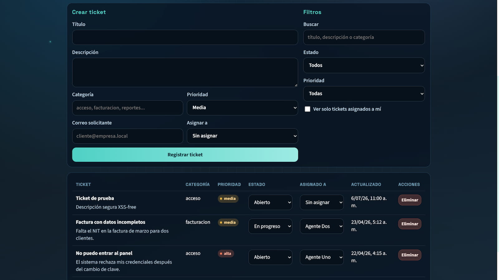

# Mesa de Ayuda — Helpdesk Ticket Management

[](https://github.com/JogerCastillo/mesa-ayuda/actions/workflows/ci.yml)
[](./LICENSE)


> A role-based ticketing app for small internal IT teams.
> Agents create and track support requests; admins oversee assignments and
> role-filtered metrics. Built as a portfolio project, not a SaaS.

## Problem

Small support teams often track requests across email, chat, or spreadsheets. Mesa de Ayuda puts ticket status,
priority, ownership, and basic operational metrics in one place. It is a lightweight portfolio alternative for
demonstrating the core workflow without a paid Zendesk/Freshdesk subscription, not a production replacement.
Its target use case is a small-business or educational team (roughly 2–10 people), not a claim about a deployed
customer.

This portfolio prototype is not a production-grade, multi-tenant, or enterprise service desk. It has no SLAs,
audit history, SSO, or durable multi-instance storage.

## Features

- JWT sign-in with an 8-hour token and a server-side, in-memory revocation list.
- `admin` and `agente` permissions enforced by the API, not only by the UI.
- Ticket status values: `abierto`, `en_progreso`, `resuelto`, and `cerrado`.
- Ticket creation; admin editing, assignment, and deletion; permitted users can update ticket status.
- Zod validation for login payloads and ticket create/update bodies.
- Case-insensitive search (`q`) across title, description, and category.
- Filters for status, priority, and tickets assigned to the current user.
- Role-filtered KPIs for total, open, in-progress, resolved, closed, and high-priority tickets (UI displays five).
- Login rate limit of 5 attempts per 15 minutes and an API limit of 100 requests per minute.
- Helmet security headers and configurable CORS allowlist; cross-origin requests are disabled if unset.
- JSON persistence using temporary files and rename-based atomic replacement.

## Tech stack

| Layer | Technology |
|---|---|
| Frontend | HTML, custom CSS, vanilla JavaScript, Tailwind CSS via CDN |
| Icons and fonts | Material Symbols and Google Fonts |
| Backend | Node.js 20 in CI, Express 4, CommonJS |
| Authentication | `jsonwebtoken` JWTs and `bcryptjs` password hashes |
| Validation | Zod |
| Persistence | JSON files with temporary-file + rename writes |
| Security | Helmet, `express-rate-limit`, CORS allowlist |
| Testing | Built-in `node:test`; 25 automated tests, no test dependencies |
| CI | GitHub Actions: backend tests and frontend static checks |
| Deployment | Netlify static frontend + Render API |

## Architecture

Production request path:

```text
+----------------------+      HTTPS       +-------------------------+
| Browser              | --------------> | Netlify                 |
| HTML / CSS / JS      | <-------------- | Static files            |
| localStorage: JWT    |                 | netlify.toml /api/*     |
+----------+-----------+                 | proxy                   |
           | /api/* + bearer JWT          +------------+------------+
           +------------------------------------------>|
                                                       | rewrite /api/*
                                                       v
                                         +-------------+-----------+
                                         | Render / Express API    |
                                         | Node.js 20              |
                                         | auth / RBAC / Zod       |
                                         +-------------+-----------+
                                                       | store.js
                                                       v
                                         +-------------------------+
                                         | JSON files under        |
                                         | DATA_DIR (atomic writes)|
                                         +-------------------------+
```

On login, the API returns a JWT in JSON and also sets an HttpOnly cookie; the browser stores the bearer token in
`localStorage`. Netlify rewrites `/api/*` to the Render host in `netlify.toml`. The API reads and writes JSON under
`DATA_DIR` (default: `backend/data`).



## Key technical decisions

### 1. JSON files instead of a database

**Decision:** persist users and tickets in local JSON files. **Why:** portable and no database provisioning for a
small prototype; atomic replacement reduces the chance of a partially written file. **Trade-off:** this is not
transaction or concurrency control: concurrent read-modify-write requests can overwrite one another. There is no
query language, indexing, or multi-instance coordination, and no ticket-count threshold has been benchmarked.
Production should use a database such as PostgreSQL (or SQLite for a deliberately single-instance service).

### 2. Eight-hour JWTs with an in-memory revocation list

**Decision:** sign access tokens that expire after eight hours and record revoked IDs in a process-local `Set`.
**Why:** avoids a separate session database; eight hours is roughly a workday. **Trade-off:** the blacklist is lost
on restart and is not shared across instances, so a token can be usable again until expiry. The client clears its
local state but does not call the API logout endpoint. Production needs shared revocation (e.g. Redis) or
server-side sessions, plus a client logout flow that uses it.

### 3. One backend entry point

**Decision:** keep routes, auth, validation, and ticket logic in `backend/src/server.js`; only JSON I/O is in
`store.js`. **Why:** straightforward for this limited portfolio scope—a simplicity choice, not an ideal long-term
design. **Trade-off:** concerns are coupled and harder to unit-test in isolation; current tests use spawned HTTP
servers. If the application grows, split routes, controllers, and services without changing endpoint behavior.

### 4. Vanilla JavaScript instead of a frontend framework

**Decision:** use browser APIs and load Tailwind from its CDN; there is no frontend build step. **Why:** small
project footprint and static deployment. **Trade-off:** no component model or automated UI tests, and the CDN is a
runtime dependency. Dynamic ticket values use `createElement` and `textContent`; `innerHTML` only clears
containers. Future HTML-string rendering needs explicit XSS-safe handling.

### 5. Per-process rate limiting

**Decision:** use the default in-memory store provided by `express-rate-limit`. **Why:** no shared-state service
for a single-process prototype. **Trade-off:** counters reset on restart and are independent across instances.
Multi-instance deployment needs a shared store (e.g. Redis) or an edge-level limit.

## Testing

The backend has 25 automated cases using Node's built-in `node:test` runner; there are no additional test
dependencies.

```bash
cd backend
npm test             # 25 tests; about 2.5 seconds in a standalone local run
npm run test:smoke   # health, login, and /me smoke check
npm run test:watch   # rerun tests on file changes
```

| File | Tests | Coverage |
|---|---:|---|
| `auth.test.js` | 6 | Login success/failure, configured `DATA_DIR`, `/me`, missing and malformed tokens |
| `rbac.test.js` | 6 | Admin/agent visibility, deletion and update permissions, permitted ticket claim |
| `validation.test.js` | 5 | Invalid create/update bodies and sanitized global 500 response |
| `tickets.test.js` | 6 | Listing, status/priority/search filters, create and update persistence |
| `kpis.test.js` | 2 | Dashboard counts for admin and agent scopes |

Each test file starts its own server on an OS-assigned port and uses a temporary `DATA_DIR`, removed on close. CI
also points the smoke test at the runner's temporary directory. When running `test:smoke` manually, set
`DATA_DIR` to a disposable directory to avoid using `backend/data`.

There is no coverage instrumentation or automated frontend test suite. Rate limiting, logout/revocation, and
browser behavior are not covered. The frontend CI job checks syntax and required tags; it is not an HTML
validator or UI test.

## Known limitations

- **“Tomar” UI/backend mismatch:** the UI offers it for any unassigned ticket, but agents can edit only tickets
  they created or that are assigned to them. They cannot claim arbitrary unassigned tickets. Whether this is
  intentional is undocumented; the UI and backend need a product decision.
- **JSON persistence** is unsuitable for concurrent writes or multiple API instances; atomic replacement does not
  prevent lost updates.
- **JWT revocation** uses an in-memory list that resets on process restart; **rate limiting** is also per-process.
- **No email or push notifications:** feedback is limited to in-app toasts.
- **No live updates:** clients must reload the ticket list to see changes by another user.
- **No automated frontend tests:** UI verification is manual.
- The default local API port is `4200`; `PORT` can override it.

## Local development

### Prerequisites

- Node.js 20 or newer and a browser. The frontend has no install or build step.

### Backend and local UI

```bash
cd backend
cp .env.example .env
npm install
npm run dev
```

Edit `.env`: set `JWT_SECRET` to a random value of at least 32 characters and `ADMIN_PASSWORD` to bootstrap the
first admin. Optionally set `AGENTE1_PASSWORD`, `AGENTE2_PASSWORD`, `BCRYPT_ROUNDS` (default 10), and `PORT`
(default 4200). On first startup, configured users are written to `backend/data/users.json`; existing users are
not replaced. The user file and `.env` are local data and must not be committed.

For the simplest local setup, open the repository's `index.html` directly (`file://`); its API URL defaults to
`http://localhost:4200/api`. Set `CORS_ORIGIN=null` for this local opaque origin only—never in production. For a
local static server, set `<meta name="api-base-url" content="http://localhost:4200/api">` before `app.js` loads
and allow that exact frontend origin in `CORS_ORIGIN`. The Netlify proxy is for deployment, not a generic local
server.

## Deployment

- **Frontend:** Netlify publishes the repository root without a build command; the `/api/*` rewrite targets Render.
- **Backend:** deploy `backend` as a Node.js service on Render. Set `JWT_SECRET` (32+ characters),
  `ADMIN_PASSWORD` for first bootstrap, and optional agent passwords or `BCRYPT_ROUNDS`; Render supplies `PORT`.
- **Persistence caveat:** confirm the selected Render plan preserves `DATA_DIR` across restarts; otherwise JSON
  changes are not durable.

CI runs on pushes and pull requests targeting `main`: `npm ci`, backend tests and smoke test, plus frontend
syntax and required-tag checks. It does not deploy the application.

## License

MIT — see [LICENSE](./LICENSE).
